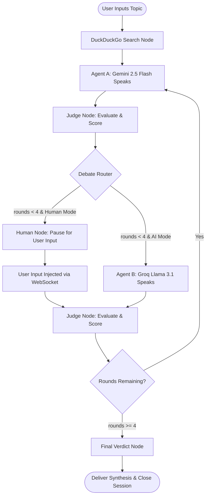

# 🧠 Neural Arbiter

<div align="center">

> **Autonomous Multi-Agent AI Debate, Real-Time Cross-Examination & Objective Adjudication System**

[](https://www.python.org/)
[](https://fastapi.tiangolo.com/)
[](https://langchain-ai.github.io/langgraph/)
[](https://react.dev/)
[](https://www.typescriptlang.org/)
[](https://vitejs.dev/)
[](https://tailwindcss.com/)
[](LICENSE)

</div>

---

## 📑 Table of Contents

- [Overview](#-overview)
- [The Problem it Solves](#-the-problem-it-solves)
- [System Architecture](#-system-architecture)
- [Key Features](#-key-features)
- [Tech Stack](#-tech-stack)
- [Project Structure](#-project-structure)
- [Getting Started](#-getting-started)
  - [Prerequisites](#prerequisites)
  - [1. Clone Repository](#1-clone-repository)
  - [2. Backend Setup](#2-backend-setup)
  - [3. Frontend Setup](#3-frontend-setup)
- [Testing & Mock Mode](#-testing--mock-mode)
- [Bring Your Own Key (BYOK) Security](#-bring-your-own-key-byok-security)
- [WebSocket API Protocol](#-websocket-api-protocol)
- [Deployment](#-deployment)
- [Roadmap](#-roadmap)
- [Author & Acknowledgements](#-author--acknowledgements)

---

## 💡 Overview

**Neural Arbiter** is a high-performance, real-time adversarial debate and multi-agent intelligence platform. Two opposing Large Language Models engage in structured, academic cross-examination over controversial, scientific, or philosophical topics. A third impartial LLM judge evaluates every round in real-time, detecting cognitive biases, cataloging logical fallacies, scoring empirical credibility (0–100), and issuing a structured, legally and academically sound final verdict.

The entire process streams live over WebSockets to a reactive frontend dashboard featuring live transcript feeds, an interactive argument relationship graph, credibility trajectory charts, and a developer state inspector.

```
       ┌────────────────────────────────────────────────────────┐
       │                Debate Topic & Context                  │
       └──────────────────────────┬─────────────────────────────┘
                                  │
                 ┌────────────────┴────────────────┐
                 ▼                                 ▼
       ┌──────────────────┐               ┌──────────────────┐
       │     Agent A      │ ◄───────────► │     Agent B      │
       │ Google Gemini    │  Adversarial  │ Groq Llama 3.1   │
       │ (Proposition)    │    Debate     │ (Opposition /    │
       │                  │     Loop      │  Human-in-Loop)  │
       └────────┬─────────┘               └────────┬─────────┘
                │                                  │
                └────────────────┬─────────────────┘
                                 │
                                 ▼
                     ┌────────────────────────┐
                     │    Impartial Judge     │
                     │  Gemini 2.5 ➔ Groq Fallback │
                     │  Structured JSON Evaluation│
                     └───────────┬────────────┘
                                 │
                                 ▼
                     ┌────────────────────────┐
                     │ Comprehensive Verdict  │
                     │  & Live Visualization  │
                     └────────────────────────┘
```

---

## 🎯 The Problem it Solves

In modern discourse, information abundance frequently leads to verification paralysis. Confirmation bias and selective sourcing allow anyone to assemble superficial arguments for virtually any stance.

**Neural Arbiter** counters this through automated adversarial synthesis:
1. **Eliminating One-Sided Echo Chambers:** LLMs are paired in dialectical opposition where every premise is immediately subjected to ruthless scrutiny by a counter-agent.
2. **Grounding via Real-Time Web Retrieval:** Debaters are armed with fresh web context before each exchange, curbing model hallucinations and anchoring claims to empirical data.
3. **Impartial, Structured Adjudication:** An independent arbitrator scores arguments deterministically using Pydantic schemas, identifying ad hominem attacks, straw men, circular reasoning, and unsubstantiated claims.
4. **Human Active Engagement:** Through Human-in-the-Loop (HITL) mode, users can step into the arena themselves and test their debate skills against state-of-the-art AI.

---

## 🏗️ System Architecture

Neural Arbiter is powered by a stateful **LangGraph** execution graph integrated with **FastAPI** WebSocket streaming and a **React 19** analytics dashboard.

### LangGraph Workflow & State Flow



### Architectural Highlights
- **Operator Concatenation Reducers:** The shared `DebateState` uses `Annotated[List[T], operator.add]` for transcript entries and argument nodes so each node returns deltas without overwriting prior debate rounds.
- **Dynamic Checkpointing & MemorySaver:** In-memory session tracking allows seamless state preservation and state resumption during human interrupts.
- **Fail-Safe Automatic Fallbacks:** The Judge node attempts primary evaluation with Google Gemini; if rate-limited or unavailable, it transparently transitions to Groq Llama 3 to maintain uninterrupted streaming.
- **Synchronized UI Reveal Pipeline:** The custom `useSyncedReveal` React hook ensures that chat bubbles, argument node graph updates, and credibility charts reveal in unison.

---

## ✨ Key Features

### 🎙️ The Debaters
- **Agent A (Google Gemini 2.5 Flash):** Argues the affirmative ("for") perspective. Calibrated for academic rigor, empirical citations, and mathematical precision.
- **Agent B (Groq Llama 3.1 8B Instant):** Argues the negative ("against") perspective. High-throughput, direct, adversarial counter-arguer. Supports alternative routing to **Claude 3 Haiku**.

### 🧑‍💼 Human-in-the-Loop (HITL) Mode
- Don't just watch the debate — take part in it. Toggle **Human Mode** on the prompt page to replace Agent B.
- LangGraph pauses execution using `interrupt_before=["human_node"]`. The WebSocket prompts the client, accepts your typed rebuttals, and feeds them into the debate loop for immediate scoring by the AI Judge.

### ⚖️ Impartial AI Judge with Dual-Engine Fallback
- **Pydantic Structured Evaluation:** Enforces strict JSON contracts for:
  - Agent credibility scores (0–100 scale).
  - Logical fallacy detection (e.g., False Dichotomy, Appeal to Authority).
  - Rhetorical bias analysis.
  - Core claim extraction with relative strength categorization.
  - Concise academic round summaries.
- **Automatic Fallback:** Primary model: `gemini-2.5-flash` → Secondary failover: `llama-3.1-8b-instant`.

### 🌐 Grounded Real-Time Web Search
- Every debate begins with automated DuckDuckGo research queries (`duckduckgo-search`).
- Top empirical snippets are synthesized and injected into debater prompt contexts, grounding arguments in factual reality.

### 📊 Real-Time Analytics Dashboard
- **Interactive Argument Graph:** Powered by `@xyflow/react` (ReactFlow). Graphically displays argument relationships, speaker tags, claim strength, and fallacies.
- **Credibility Trajectory Chart:** Built with `recharts`. Visualizes dynamic round-by-round credibility momentum for both debaters.
- **Live Debate Feed:** Color-coded, animated streaming transcript with speaker status badges.
- **Final Verdict Card:** Comprehensive post-debate synthesis with verdict analysis, evidence confidence percentage, identified biases, and a definitive bottom-line conclusion.

### 🔒 Zero-Retention BYOK (Bring Your Own Key) Security
- Users can input their own Google AI Studio and Groq API keys directly in the frontend modal.
- Keys are kept exclusively in volatile, in-memory thread state (`MemorySaver`) for the duration of the debate session.
- **Keys are never written to disk, never logged, and stripped from outbound WebSocket payloads.**

### 🧪 Zero-Cost Mock & Test Mode
- Fully offline simulation mode (`TEST_MODE=true`).
- Test frontend layouts, WebSocket loops, and graph animations without consuming any API credits or requiring API keys.

### 🛠️ Developer Mode State Inspector
- Press <kbd>Shift</kbd> + <kbd>D</kbd> anywhere on the dashboard to open the floating **Dev Mode Panel**.
- Inspect live WebSocket connection status, current speaker, round count, HITL flags, and raw JSON state snapshots in real-time.

---

## 🛠️ Tech Stack

| Domain | Technology / Library | Purpose |
|---|---|---|
| **Orchestration** | [LangGraph](https://langchain-ai.github.io/langgraph/) | Cyclic state machine, routing, and human-in-the-loop interrupts |
| **Framework** | [FastAPI](https://fastapi.tiangolo.com/) + [Uvicorn](https://www.uvicorn.org/) | Asynchronous backend and high-performance WebSocket server |
| **Agent A** | [Google Gemini 2.5 Flash](https://aistudio.google.com/) | Primary debater (affirmative position) |
| **Agent B** | [Groq Llama 3.1 8B](https://groq.com/) / Claude | Secondary debater (negative position) |
| **Judge Engine** | Gemini 2.5 Flash ➔ Groq Llama 3.1 | Impartial structured adjudication with automatic fallback |
| **Web Research** | [duckduckgo-search](https://pypi.org/project/duckduckgo-search/) | Real-time web retrieval grounding |
| **Data Validation** | [Pydantic v2](https://docs.pydantic.dev/) | Structured JSON output guarantees for judge verdicts |
| **Frontend UI** | [React 19](https://react.dev/) + [Vite](https://vitejs.dev/) | High-performance reactive user interface |
| **Language** | [TypeScript](https://www.typescriptlang.org/) | End-to-end type safety for data models and state streams |
| **Styling** | [Tailwind CSS v4](https://tailwindcss.com/) | Futuristic dark-mode interface and glassmorphism styling |
| **Graph Visualization** | [@xyflow/react](https://reactflow.dev/) (ReactFlow) | Dynamic argument and fallacy relationship node graph |
| **Charts** | [Recharts](https://recharts.org/) | Real-time credibility score trajectories |
| **Icons** | [Lucide React](https://lucide.dev/) | UI iconography |
| **Deployment** | [Render](https://render.com/) | Multi-service cloud deployment configuration (`render.yaml`) |

---

## 📁 Project Structure

```text
Neural-arbiter/
├── .env.example              # Root environment variables template
├── .gitignore                # Git ignore configuration
├── render.yaml               # Cloud deployment blueprint (FastAPI + Static React)
├── README.md                 # Project documentation
│
├── backend/                  # FastAPI & LangGraph Backend
│   ├── .env.example          # Backend environment variables template
│   ├── requirements.txt      # Python dependencies
│   ├── main.py               # FastAPI application, WebSocket lifecycle, BYOK security
│   ├── graph.py              # LangGraph workflow, routers, & checkpointing
│   ├── models.py             # TypedDict state definition with operator reducers
│   ├── config.py             # API keys, model constants, test-mode tripwires
│   ├── debater_node.py       # Debater node implementations (Gemini & Groq)
│   ├── judge_node.py         # Round judge & final verdict nodes (Pydantic schemas)
│   └── search_node.py        # DuckDuckGo live web research integration
│
└── frontend/                 # React 19 + TypeScript + Vite Frontend
    ├── package.json          # Node.js dependencies & scripts
    ├── tsconfig.json         # TypeScript compiler configuration
    ├── vite.config.ts        # Vite build tool configuration
    ├── index.html            # Application entrypoint HTML
    └── src/
        ├── App.tsx           # Main application shell & state orchestration
        ├── main.tsx          # React DOM root render
        ├── types.ts          # TypeScript interfaces for WebSocket state & graph
        ├── components/
        │   ├── PromptPage.tsx     # Gemini/Claude-style landing page with suggestion chips
        │   ├── DashboardNav.tsx   # Top navigation bar with round indicators & actions
        │   ├── Chat.tsx           # Live debate transcript feed
        │   ├── Graph.tsx          # Interactive ReactFlow argument node graph
        │   ├── Chart.tsx          # Real-time Recharts credibility score tracker
        │   ├── FinalVerdict.tsx   # Post-debate verdict modal & synthesis breakdown
        │   ├── Sidebar.tsx        # Round summaries, search snippets, & bias indicators
        │   ├── ApiModal.tsx       # BYOK API key configuration modal
        │   └── Navbar.tsx         # Header component
        └── hooks/
            ├── useDebate.ts       # WebSocket connection management & payload dispatch
            └── useSyncedReveal.ts # Synchronized state reveal animation coordinator
```

---

## 🚀 Getting Started

### Prerequisites
- **Python 3.10+**
- **Node.js 18+** & **npm 9+**
- (Optional for Live Mode) [Google AI Studio API Key](https://aistudio.google.com/)
- (Optional for Live Mode) [Groq Cloud API Key](https://console.groq.com/)

---

### 1. Clone Repository

```bash
git clone https://github.com/vatsal-mittal-7904/Neural_Arbiter..git
cd Neural-arbiter
```

---

### 2. Backend Setup

```bash
# Navigate to backend directory
cd backend

# Create and activate Python virtual environment
python3 -m venv venv
source venv/bin/activate       # On Windows: venv\Scripts\activate

# Install dependencies
pip install -r requirements.txt

# Configure environment variables
cp .env.example .env
```

Edit `backend/.env` with your preferred settings:
```env
# Set to false to use live API keys, or true for offline mock mode
TEST_MODE=false

GOOGLE_API_KEY=your_google_ai_studio_api_key_here
GROQ_API_KEY=your_groq_api_key_here
ANTHROPIC_API_KEY=your_anthropic_api_key_here
```

**Start the Backend Server:**
```bash
python3 main.py
# Or with uvicorn directly:
# uvicorn main:app --host 0.0.0.0 --port 8000 --reload
```
* Backend runs at: `http://localhost:8000`
* WebSocket endpoint: `ws://localhost:8000/ws/debate`
* Health check: `http://localhost:8000/health`

---

### 3. Frontend Setup

In a new terminal window:

```bash
# Navigate to frontend directory
cd frontend

# Install dependencies
npm install

# Start the development server
npm run dev
```
* Frontend runs at: `http://localhost:5173`

Open your browser to `http://localhost:5173` to explore Neural Arbiter.

---

## 🧪 Testing & Mock Mode

Neural Arbiter includes a comprehensive **Mock Engine** that allows developers to test the entire debate flow without spending API credits or needing active API keys.

1. In `backend/.env`, set:
   ```env
   TEST_MODE=true
   ```
2. Alternatively, in the UI:
   - Click the **API Keys** button on the landing page.
   - Toggle **"Enable Test Mode (Mock Responses)"**.
   - Start any debate — mock data, simulated DuckDuckGo snippets, and preset credibility scores will flow smoothly through the WebSocket pipeline.

---

## 🔑 Bring Your Own Key (BYOK) Security

Neural Arbiter is designed with a strict zero-retention privacy policy:

1. **Client-Side Storage Only:** Keys entered into the API modal are held in React state and local storage on the client machine.
2. **Ephemeral Memory Injection:** Keys sent in the initial WebSocket payload are stored only inside LangGraph's in-memory `MemorySaver` thread for that specific debate session.
3. **Never Written to Disk:** The backend server never logs or saves your API keys to files or databases.
4. **Stripped on Outbound Payloads:** The backend explicitly purges the `user_keys` dictionary from all state broadcasts before sending updates over WebSockets.

---

## 📡 WebSocket API Protocol

### Connection URL
```text
ws://localhost:8000/ws/debate
```

### 1. Initiate Debate (Client ➔ Server)
```json
{
  "topic": "Should Artificial General Intelligence development be paused?",
  "human_in_loop": false,
  "user_keys": {
    "GOOGLE_API_KEY": "AIzaSy...",
    "GROQ_API_KEY": "gsk_...",
    "is_test_mode": false
  }
}
```

### 2. State Snapshot Broadcast (Server ➔ Client)
```json
{
  "topic": "Should Artificial General Intelligence development be paused?",
  "current_speaker": "Agent A",
  "rounds_completed": 1,
  "transcript": [
    {
      "speaker": "Agent A",
      "text": "The existential risk calculus mandates strict regulatory sandboxes..."
    }
  ],
  "argument_nodes": [
    {
      "id": "A-R1",
      "speaker": "Agent A",
      "claim": "Unregulated recursive self-improvement poses an existential risk.",
      "strength": "strong",
      "fallacy": "none"
    }
  ],
  "credibility_scores": {
    "Agent A": [85],
    "Agent B": []
  },
  "web_context": ["..."],
  "latest_bias": "Precautionary principle orientation",
  "round_summary": "Agent A opened with an empirical risk-benefit framing.",
  "final_verdict": null,
  "is_human_mode": false,
  "human_input": ""
}
```

### 3. Human Input Injection (Client ➔ Server in HITL Mode)
```json
{
  "human_input": "Historical precedent indicates technological moratoria merely drive research underground."
}
```

---

## ☁️ Deployment

The repository includes a ready-to-use `render.yaml` configuration for seamless deployment on [Render](https://render.com/).

### Services Configured
1. **Backend Web Service (`arbiter-backend`):**
   - Environment: Python 3.10+
   - Start Command: `cd backend && uvicorn main:app --host 0.0.0.0 --port $PORT`
   - Configurable Environment Variables: `GOOGLE_API_KEY`, `GROQ_API_KEY`, `ANTHROPIC_API_KEY`.
2. **Frontend Static Site (`arbiter-frontend`):**
   - Build Command: `cd frontend && npm install && npm run build`
   - Publish Directory: `frontend/dist`
   - Automatically references backend host for WebSocket routing.

To deploy, connect your GitHub repository to Render and choose **New Blueprint Instance**.

---

## 🗺️ Roadmap

- [ ] **Recursive Self-Correction:** Pre-speech self-reflection node where agents review their own arguments before posting.
- [ ] **Multi-Modal Evidence:** Agents dynamically generate and retrieve charts, statistical figures, and scientific diagrams.
- [ ] **Expanded Agent Panels:** Support for 3+ debaters (Round-Robin & Parliamentary debate styles).
- [ ] **Exportable PDF Debriefs:** One-click download of debate transcripts, fallacy breakdowns, and judge scorecards.
- [ ] **Custom Judge Personas:** Toggleable judicial philosophies (e.g., Strict Empiricist, Socratic Inquirer, Legal Pragmatist).

---

## 👨‍💻 Author & Acknowledgements

**Vatsal Mittal**
- GitHub: [@vatsal-mittal-7904](https://github.com/vatsal-mittal-7904)
- Repository: [Neural_Arbiter.](https://github.com/vatsal-mittal-7904/Neural_Arbiter..git)

*Built with passion for autonomous multi-agent intelligence, dialectical reasoning, and transparent AI evaluation.*

---

## 📄 License

This project is licensed under the **MIT License** — see the [LICENSE](LICENSE) file for details.